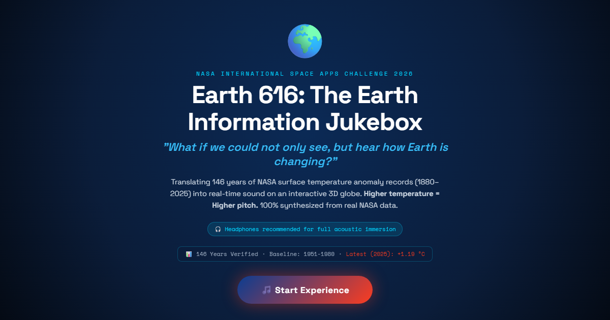
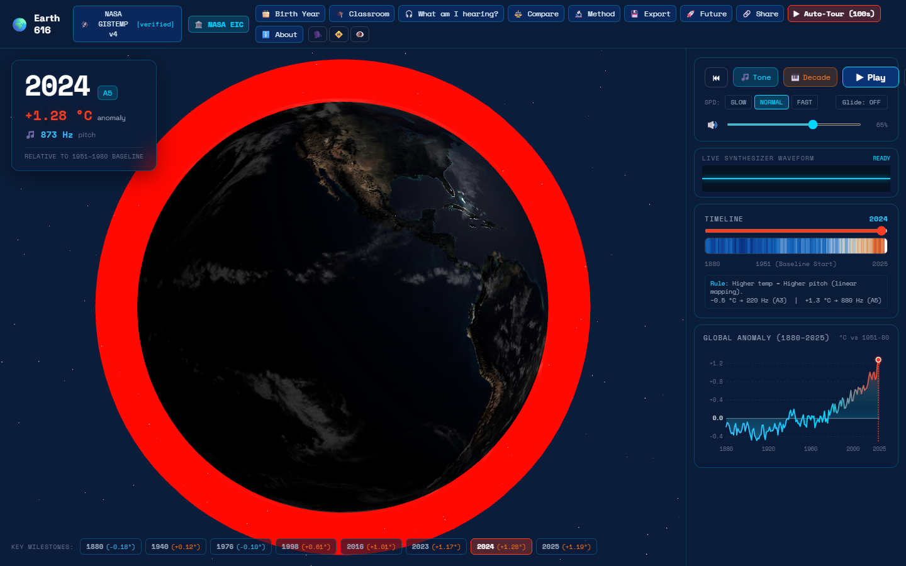
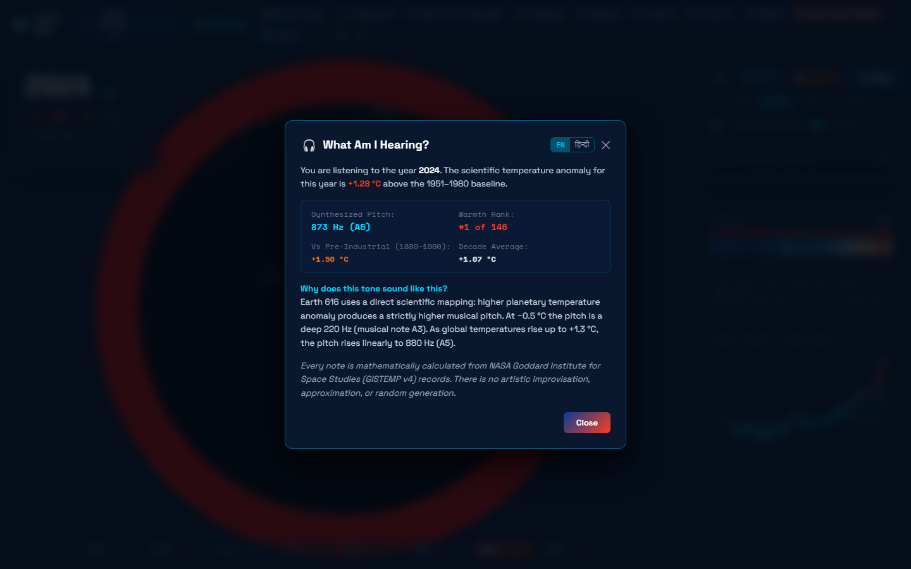
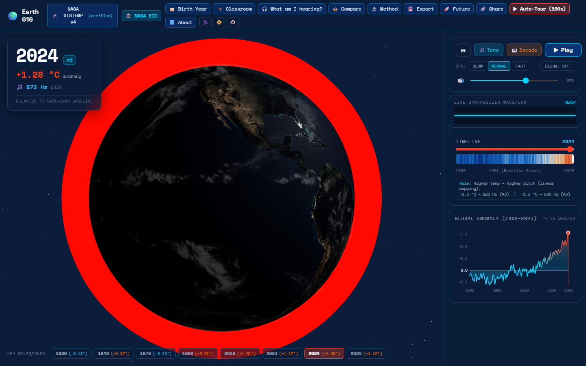
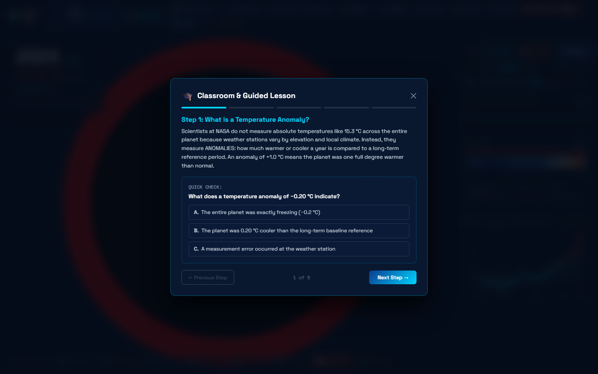

# 🌍 Earth 616: The Earth Information Jukebox

> **NASA International Space Apps Challenge 2026**  
> *Challenge:* The Earth Information Jukebox  
> *Event:* Bhopal, India (Local Event)  
> *Team:* **Earth 616**  
> *Live Demo:* **[https://earth-jukebox.vercel.app](https://earth-jukebox.vercel.app)** *(or your deployment URL)*  
> *Demo Video:* **[Watch the 100-Second Demonstration Video](#)** *(Public / Unlisted link)*

---



---

## 1. The Core Idea: What if We Could Hear How Earth is Changing?

Earth observation visualizations created by NASA are visually stunning, but they can feel abstract on 2D charts and remain inaccessible to visually impaired audiences.

**Earth 616: The Earth Information Jukebox** pairs **NASA Earth Information Center (EIC) visual frames** with **dynamic real-time sonification**. Every year's authentic NASA surface temperature anomaly from 1880 to 2025 is mapped to an exact, deterministic musical pitch: **higher temperature = higher pitch**.

Unlike subjective "climate music", Earth 616 upholds **strict scientific honesty**:
- Zero randomized notes or artistic approximations.
- 100% synthesized in real time via the browser's native **Web Audio API** (zero audio files).
- All numbers, ranks, and baselines are computed dynamically from real NASA GISTEMP v4 data.

---

## 2. Interactive Features

| Feature | Description | File / Implementation |
| :--- | :--- | :--- |
| **🌐 3D Interactive Earth** | Photorealistic rotating WebGL planet featuring NASA Blue Marble day textures, Black Marble night lights on the dark hemisphere, surface normals, ocean specular reflection, and independent orbital clouds. | `src/globe/EarthGlobe.tsx` |
| **🎨 EIC Frame Jukebox** | Computer vision engine (Sobel 3×3 edge detection, 12-bin HSL hue histograms, color warmth ratios, spatial centroids) sonifying NASA visual frames into real-time stereo soundscapes with scanline tracking. | `src/vision/frameAnalyzer.ts`, `src/vision/frameSonifier.ts`, `src/ui/JukeboxTab.tsx` |
| **🎼 Musical Scales & Synthesis** | Multi-voice synthesizer with dual detuned oscillators, 4 musical quantization modes (Pentatonic, Dorian, Lydian, Aeolian) alongside scientific Hz mode, climate urgency vibrato LFO, and 55Hz sub drone bed. | `src/audio/sonify.ts`, `src/audio/engine.ts` |
| **🔥 Data-Driven Atmosphere** | Custom GLSL Fresnel shader lerps atmospheric rim glow from cool blue (`< -0.2 °C`), through icy cyan, to solar red (`+1.28 °C`). | `src/globe/EarthGlobe.tsx` |
| **🔊 Real-Time Sonification** | Dual-oscillator engine (fundamental sine + warm 2nd harmonic), anti-click envelope, algorithmic 2.2s space reverb, and `DynamicsCompressorNode` limiter. | `src/audio/sonify.ts`, `src/audio/engine.ts` |
| **📹 Built-in Clip Recorder** | Direct canvas + Web Audio stream recording via `MediaRecorder` into high-quality WebM clips with live timestamp overlay for presentations and submissions. | `src/utils/screenRecorder.ts` |
| **🌓 Dual Theme Engine** | Deep Space dark theme and Daylight high-clarity light theme with instant toggle and local storage persistence. | `src/ui/MainExperience.tsx` |
| **🎂 Hear Your Birth Year** | Input any birth year: auditions your birth year against today's record warmth with a plain-language lifetime warming summary. | `src/ui/BirthYearModal.tsx` |
| **🎓 Classroom / Guided Mode** | 5-step interactive educational lesson on anomalies, baselines, and historical inflection points with instant-feedback quizzes. | `src/ui/ClassroomModal.tsx` |
| **🏛️ NASA EIC Portal** | Direct bridge connecting our sonification engine to official NASA Earth Information Center visual frames at `earth.gov`. | `src/ui/EICModal.tsx` |
| **🎹 Decade Chords** | Auditions 10-year period averages as warm sustained chords with individual yearly notes arpeggiated across 2.5 seconds. | `src/audio/engine.ts` |
| **📊 Warming Stripes Scrubber** | 146-band Ed Hawkins climate stripes under the timeline acting as a direct click-to-jump scrubber with milestone chips. | `src/ui/TimelineSlider.tsx` |
| **📈 Vector Anomaly Chart** | Zero-dependency SVG temperature anomaly line chart with baseline zero-line, playhead indicator, and hover inspection. | `src/ui/TemperatureChart.tsx` |
| **🎧 "What Am I Hearing?"** | Offline bilingual (**English / हिन्दी**) explainer computing historical rank (#1 to #146), pre-industrial deltas, and decade normals. | `src/ui/ExplainerModal.tsx` |
| **⚖️ Comparative Mode** | Audition any two historical years back-to-back with live $\Delta ^\circ\text{C}$ and $\Delta\text{ Hz}$ delta calculations. | `src/ui/CompareModal.tsx` |
| **💾 Media Exporter** | Synthesize and download the 146-year time-lapse or custom frame soundscapes as uncompressed 16-bit WAV files (`OfflineAudioContext`) or chart as PNG. | `src/audio/exportWav.ts`, `src/vision/frameSonifier.ts`, `src/ui/ExportModal.tsx` |
| **🔗 Shareable State URLs** | Bookmarks and shares exact year, speed, and mode configurations via URL query parameters (`?year=...`). | `src/utils/urlState.ts` |
| **▶ 100-Second Auto-Tour** | Scripted guided run with synchronized on-screen English subtitles for presentations and judge evaluations. | `src/ui/AutoTour.tsx` |

---

## 3. Screenshots

| 3D Globe & Mission Control | "What Am I Hearing?" Bilingual Explainer |
| :---: | :---: |
|  |  |
| **Mission Control Sidebar** | **Classroom Guided Lesson** |
|  |  |

---

## 4. Exact Deterministic Sonification Rule

$$\text{Frequency (Hz)} = 220.0 + \left(\frac{\text{clamp}(\text{Anomaly}, -0.5, 1.3) - (-0.5)}{1.3 - (-0.5)}\right) \times (880.0 - 220.0)$$

- **−0.50 °C:** 220.0 Hz (Musical note **A3**)
- **0.00 °C Baseline Normal:** 403.3 Hz (Musical note **G4**)
- **+0.90 °C Verification Test:** 733.3 Hz (Musical note **F#5**)
- **+1.30 °C Upper Bound:** 880.0 Hz (Musical note **A5**)
- Clamping is strictly applied to any anomaly values outside the $[-0.5, +1.3]$ range.

---

## 5. Reproduce Our Data in 3 Commands

To guarantee absolute scientific reproducibility, anyone can reproduce our bundled dataset directly from NASA servers:

```powershell
# 1. Download and validate live NASA GISTEMP v4 dataset
npm run fetch-data

# 2. Run automated test suite (26/26 tests verifying formulas, color math, monotonicity, and parsing)
npm run test

# 3. Execute unified quality gate (validates dataset, tests, and builds static bundle)
npm run verify
```

---

## 6. Real NASA Data Pipeline

All scientific measurements originate from the **NASA Goddard Institute for Space Studies (GISS)**:
- **Product:** Surface Temperature Analysis (GISTEMP v4), Global Land-Ocean Temperature Index (`GLB.Ts+dSST.csv`)
- **Direct NASA URL:** `https://data.giss.nasa.gov/gistemp/tabledata_v4/GLB.Ts+dSST.csv`
- **Data Pipeline:** `scripts/fetch-data.mjs` streams the CSV from NASA servers, extracts the annual mean (`J-D` column), validates 146 consecutive years (1880–2025) without gaps or missing numbers, and compiles `public/data/gistemp.json`.
- The bundled JSON is shipped with the app so that Earth 616 operates 100% offline without live NASA network dependencies.

---

## 7. Universal Accessibility (WCAG 2.1 AA)

- **Keyboard Navigation:** Full operation using `ArrowLeft` / `ArrowRight` (±1 year), `PageUp` / `PageDown` (±10 years), `Home` (1880), `End` (2025), `Space` (Play single tone), and `P` (Toggle time-lapse).
- **Screen Reader Announcements:** High-priority `aria-live="polite"` region continuously announces:  
  *e.g., "Year 2015, anomaly plus 0.90 degrees Celsius, pitch 733 hertz."*
- **Speech Synthesis:** Built-in Web Speech API (`speechSynthesis`) toggle for auditory readouts.
- **High-Contrast Mode:** High-contrast palette toggle for visibility.
- **Reduced Motion Support:** Respects `prefers-reduced-motion` and includes an on-screen toggle to stop globe auto-rotation and ripple effects.
- **Multimodal Feedback:** Information is never encoded solely by color; numerical labels, units, and frequencies accompany every visualization.

---

## 8. Limitations & Uncertainty Disclosure

- **Annual Global Mean:** Represents whole-planet thermodynamic energy balance, not daily local weather variations.
- **Climatological Baseline:** Temperatures are expressed as anomalies relative to the 1951–1980 baseline normal.
- **Uncertainty Bounds:** Because individual uncertainty columns are not provided in the simplified J-D summary table (`GLB.Ts+dSST.csv`), *uncertainty bounds are not plotted on the line chart* to avoid inventing numbers.

---

## 9. Submission Documents & Deliverables

- 📄 **Portal Narrative:** [SUBMISSION.md](SUBMISSION.md)
- 📋 **Submission Checklist:** [SUBMISSION_CHECKLIST.md](SUBMISSION_CHECKLIST.md)
- 🎨 **Artistic & Technical Rationale:** [docs/ARTISTIC_AND_TECHNICAL_RATIONALE.md](docs/ARTISTIC_AND_TECHNICAL_RATIONALE.md)
- 🔬 **References & Citations:** [REFERENCES.md](REFERENCES.md) & [REFERENCES_PORTAL.txt](REFERENCES_PORTAL.txt)
- 🛡️ **Originality Disclosure:** [ORIGINAL_WORK.md](ORIGINAL_WORK.md)
- 🤖 **AI Assistance Disclosure:** [AI_DISCLOSURE.md](AI_DISCLOSURE.md)
- 🎬 **Video Demonstration Script:** [DEMO_SCRIPT.md](DEMO_SCRIPT.md) & [demo.srt](demo.srt)
- 🚀 **Deployment Guide:** [DEPLOY.md](DEPLOY.md)
- 📝 **Implementation Audit:** [docs/JUDGING_AUDIT.md](docs/JUDGING_AUDIT.md)

---

## 10. License

This project is open-source under the [MIT License](LICENSE).  
Copyright © 2026 Team Earth 616.
